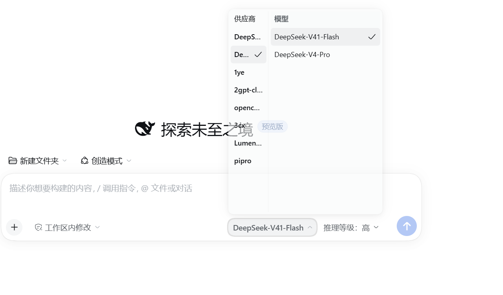

# dsh-personal-model-picker

DSH（DeepSeek Harness）的**紧凑双栏模型选择器**：左栏供应商、右栏模型，鼠标悬停左栏即切换右栏；输入框旁的触发器同时显示当前模型与推理等级。



> **非官方插件**，改编自官方包 `@deepseek-ai/dsh-client-ui-model-selection`（MIT，`Copyright (c) 2026 DeepSeek`），不是 DeepSeek 发布或背书的作品。

> **同作者的另一个插件已独立成库**：[`dsh-reasoning-effort`](https://github.com/JuYueYe/dsh-reasoning-effort) —— 设置 → 模型里每张 pi-ai 提供商卡片的模型目录编辑器（逐模型「思考模式」开关 + 七档勾选）。两者互相独立、无依赖，各自装各自的：
>
> ```bash
> dsh plugin --profile web add github:JuYueYe/dsh-personal-model-picker   # 本包：双栏选择器
> dsh plugin --profile web add github:JuYueYe/dsh-reasoning-effort       # 那个：模型目录编辑器
> ```

## 改了什么

它**替换**官方的模型入口，而不是叠加：bundle patch 先禁用官方 `ui-model-selection` 条目，再插入自己。相对官方，只有下面这些差异，功能语义保持一致。

| # | 变更点 | 官方 | 本插件 |
|---|---|---|---|
| 1 | 供应商 / 模型选择 | 逐级钻取：根菜单 → 该菜单里的模型列表 | **双栏并列**：左供应商、右模型；悬停（或聚焦、点击）左栏即切换右栏，两栏各自滚动 |
| 2 | 面板高度 | 随内容变化 | **固定 348px**（28px 列头 + 320px 模型列 + 卡片内边距），不随悬停供应商的模型数量变化 |
| 3 | 触发器 | 只显示模型名 | 模型名 **+ 推理等级** |
| 4 | 推理等级 | 根菜单里的一行 | 触发器上直接显示当前值，展开为独立一栏 |
| 5 | 与官方共存 | — | **互斥替换**：`cordis.patch.yml` 里 `disabled: true` 官方入口 + `insert` 本插件 |
| 6 | 面板背景 | 玻璃质感：`--dsw-menu-surface-fill`（浅色 58% / 深色 45% 不透明）+ `backdrop-filter: blur(40px)` | **不透明**：`--dsw-alias-bg-layer-1`（浅色 `#fff` / 深色 `#232324`），后方内容不会透出来 |

**没有改的部分**（与官方行为一致）：`/model` 命令照常可用；两个入口共用同一份 per-session 模型目录，从哪个入口改结果都一样；子代理会话一律不可选模型；目录加载失败时按供应商分组列出失败行并可重新加载。

> **为什么高度必须是常量**：面板按**下边缘**定位（`top = 触发器上沿 − 8 − 实测高度`）。高度若跟随悬停供应商的模型数量变化，面板顶边就会上下移动，静止的指针下方随即换成另一个供应商，于是触发换栏、再次改变高度——形成「界面上下乱跳」的反馈环。固定高度后，悬停只切换右栏内容。

> **为什么背景要不透明**：官方面板是浅色 58% / 深色 45% 不透明的填充，加 `backdrop-filter: blur(40px) saturate(150%)` 凑出来的玻璃质感。本插件不套那层模糊，若沿用同一个半透明填充，面板就会直接“看穿”到后面的正文与输入框。因此这里改用不透明的 `--dsw-alias-bg-layer-1`（浅色 `#fff` / 深色 `#232324`），随主题切换；模型列的吸顶表头用同一个 token。

**版本与兼容**

- 当前版本 `1.1.2`。已在 DSH 核心 `0.2.0-rc.2`（官方桌面端 nightly）实测通过；原始改编基线为 `0.1.5-rc.2`。
- 图标导出随核心版本改过名：0.1.5 时代是 `IconXxx14` / `IconXxx16`，`0.2.0-rc.2` 起统一为 `IconXxxRegular`。本插件按 `...Regular` 取名——名字对不上时图标取到 `undefined`，React 渲染 `<undefined />` 会抛错，座位项被槽机制除名（`abdicate`），表现为**模型入口整个消失**（而不是样式错乱）。换核时先核对 `@deepseek-ai/dsh-client-ui-primitives` 的实际导出。
- 用词与官方对齐：`推理等级`（官方 `menu.effort`）。

## 怎么安装

1. 在 DSH 当前 profile 的 **Plugins 页**安装，填：

   ```
   github:JuYueYe/dsh-personal-model-picker
   ```

   需要钉死某个版本时加 ref：

   ```
   github:JuYueYe/dsh-personal-model-picker#<commit>
   ```

   安装时插件管理器会把本包追加进该 profile 的 `dsh.profile.bundles` 并默认启用；**仅下载依赖不会启用 bundle patch**，若装完没生效，先确认 bundles 列表里有它。

2. **刷新页面**（Ctrl+R）。打包版里客户端插件的新增不会免刷新生效；若输入框旁仍无变化，重启宿主。

### 更新

依赖规格不带 ref 时，lockfile 会把 commit 钉住，直接重装通常显示 `Already up to date` 而拉不到新提交。任选其一：

```bash
cd <DSH_HOME>/profiles/<profile>
pnpm update dsh-personal-model-picker
```

- 卸载后重装；
- 或用带新 `#<commit>` 的规格安装。

### 卸载 / 回滚

停用该 bundle，或把它从 `dsh.profile.bundles` 移除，然后**重启宿主**，官方模型入口即恢复。本插件只禁用官方那一个 entry、不直接改官方文件，因此移除后不会留下需要手工修复的残留。

## 变更

### 1.1.4 · 1.1.5

- **供应商名不再被截断**。左栏原来是 `1fr : 3fr`、卡片宽度又跟着触发器走，供应商名一长就只剩 `2gpt-...`、`disc...`。现在：卡片最窄 **420px**（上限 560px，受视口 `-24px` 夹紧）、两栏改成 **40% : 1fr**、供应商名 **`white-space: normal` + `overflow-wrap: anywhere` 换行**而不是省略号 —— 再长的名字也完整可见，行高随内容增长，列表照常滚动。
- **同时压掉了样式表的 420px 上限**：`.menu` 里写着 `max-width: min(420px, 100vw - 32px)`，只改内联 `width` 的话实际仍被卡在 420，多算的宽度会静默失效。现在 `maxWidth` 一并用同一份计算值覆盖。

### 1.1.3

- **修**：`select()` 只处理了 `{ok:false}`，没兜住 RPC **抛异常**（连接断、超时）。异常时状态会永远停在 `selecting`，而 `busy` 会让所有模型行和推理等级触发器变成 `disabled` —— 用户连重试都点不了，只能整页刷新。现在异常同样落到 `status:"error"`，菜单里那根「重新加载」横条可以继续用。
- **修**：推理等级名原来硬编码了七个中文（`关闭/最低/低/…`），英文字典里没有对应 key，英文界面下整栏仍是中文。改为 `effort.level.*` 七个字典键（zh/en 各一套），Host 已本地化好的显示名仍原样透传。
- **修**：图标改防御式解析（`iconOrNull`）。核心把 `IconXxx14/16` 改名成 `IconXxxRegular` 之后，缺失导出会让 React 渲染 `<undefined/>` 抛错、槽位 `abdicate`、**整个模型入口消失**。现在缺图标只是少个图标。
- **修**：`moveFocus` 跳过 `disabled` 行。选择进行中所有模型行都是 disabled，`focus()` 静默失败，方向键看着像失灵。
- **改**：悬停换栏加了 90ms 意图延迟。指针从供应商列斜着移向模型列时会擦过别的供应商行，原来右栏会在移动途中跳一次；聚焦和点击仍然即时切换。
- **清理**：错误信息与 effect 标签里残留的 `ui-model-selection:` 前缀改回本包名，排查日志时不再指向官方包。

## 开发与构建

**`src/` 是唯一需要手改的地方**，`dist/client.cjs` 由它生成：

```bash
npm run build     # 由 src/ 重新生成 dist/client.cjs + dist/index.js
npm run verify    # 只校验 dist 是否与 src 一致（CI / prepack 用这个）
npm run check     # 产物语法检查
```

`scripts/build.mjs` 做的是纯文本拼接（不引入打包器）：按固定顺序取 `src/` 的八个 region，套上 `window.__ModuleLoader__.load({id, factory})` 外壳与 `return module.exports;` 尾巴，并把换行统一归一成 LF（`.gitattributes` 虽然钉了 `eol=lf`，Windows 上的手改仍可能写进 CR）。新增 region 文件时，同时把它加进 `scripts/build.mjs` 的 `REGIONS` 数组。

`prepack` 已挂 `verify` —— `npm pack` 或发布前如果 `dist/` 落后于 `src/`，会直接失败而不是静默发出旧产物。

## 许可与来源

MIT，版权归上游，完整声明见 [THIRD_PARTY_NOTICES.md](THIRD_PARTY_NOTICES.md)。React 与 DSH 宿主服务由宿主提供，本包不随附另一套运行时。

- 官方元数据：https://registry.npmjs.org/@deepseek-ai%2fdsh-client-ui-model-selection/0.1.5-rc.2
- 上游仓库：https://github.com/deepseek-ai/deepseek-harness → `packages/client/ui-model-selection`

内部实现（界面细节、数据流、边界行为、字典、目录结构、构建与校验）见 [docs/INTERNALS.md](docs/INTERNALS.md)。
